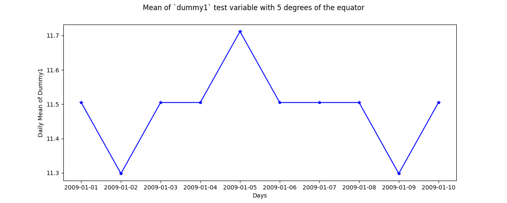

.. _tutorial_custom:

Custom Functions
----------------

Science analysis is built upon custom data processing. To simplify this task,
and enable instrument independent analysis, custom functions may be attached to
the :py:class:`~GeospaceDataManagement._instrument.Instrument` object. Each
function is run automatically when new data is loaded before it is made
available in :py:attr:`Instrument.data`.

This feature enables a user to hand a
:py:class:`~GeospaceDataManagement._instrument.Instrument` object to an
independent routine and ensure any desired customizations required are performed
without any additional user intervention. This feature enables for the
transparent modification of a data set in between its state at rest on disk and
when the data becomes available for use in :py:attr:`Instrument.data`.

.. warning:: Custom arguments and keywords are supported for these functions.
   However, these arguments and keywords are only evaluated initially when the
   function is attached to an Instrument object. Thus the objects passed in must
   be static or capable of updating themselves from within the custom function
   itself.

Example Function
^^^^^^^^^^^^^^^^

If a custom function is attached to an
:py:class:`~GeospaceDataManagement._instrument.Instrument` object,
:py:mod:`GeospaceDataManagement` expects that the first argument to be passed
to the function is the
:py:class:`~GeospaceDataManagement._instrument.Instrument` object, which will
be modified in place.  Thus, nothing should be returned from the function.
There is no :py:class:`~GeospaceDataManagement._instrument.Instrument` copy
made in memory. The example below is appropriate to be applied to an
:py:class:`~GeospaceDataManagement._instrument.Instrument` object during
the load process.

.. code:: python

   def modify_value(inst, param_name, factor=1.0):
       """Modify param_name in inst by multiplying by factor

       Parameters
       ----------
       inst : gdm.Instrument
           Object to be modified
       param_name : str
           Label for variable to be multiplied by factor
       factor : int or float
           Value to apply to param_name via multiplication (default=1.0)

       """
       # Save the old data
       inst['old_{:s}'.format(param_name)] = inst[param_name]

       # Modify the data by multiplying it by a specified value
       inst[param_name] = inst[param_name] * factor

       # Changes to the instrument object are retained
       inst.modify_value_was_here = True

       return

Attaching Custom Function to an Instrument
^^^^^^^^^^^^^^^^^^^^^^^^^^^^^^^^^^^^^^^^^^

Custom functions must be attached to an
:py:class:`~GeospaceDataManagement._instrument.Instrument` object for
:py:mod:`GeospaceDataManagement` to automatically apply the function upon every
load.

.. code:: python

   import GeospaceDataManagement as gdm

   inst = gdm.Instrument('gdm', 'testing')

   # Load data
   inst.load(2009, 1)

   # Establish current values for 'mlt'
   print(inst['mlt'])
   stored_data = inst['mlt'].copy()

   # Attach a custom function and demonstrate execution
   inst.custom_attach(modify_value, args=['mlt'], kwargs={'factor': 2.0})

   # `modify_value` is executed as part of the `ivm.load` call.
   inst.load(2009, 1)

   # Verify result is present
   print(inst['mlt'], stored_result)

   # Check for attribute added to the Instrument
   print(inst.modify_value_was_here)

   # `modify_vaule` is executed by `ivm.load` call.
   inst.load(2009, 1)

   # Verify results are present
   print(inst[['old_mlt', 'mlt']], stored_result)

   # Can also set functions via its string name. This example includes
   # both required and optional arguments, and requires output from
   # the prior custom function
   inst.custom_attach('modify_value', args=['old_mlt'], kwargs={'factor': 3.0})

   # All three functions are executed with each load call in the order they
   # were attached.
   inst.load(2009, 1)

   # Verify results are present
   print(inst[['old_mlt', 'old_old_mlt', 'mlt']], stored_result)

The output of from these and other custom functions will always be available
from the :py:class:`~GeospaceDataManagement._instrument.Instrument` object,
regardless of what level the science analysis is performed.

We can repeat the earlier example, this time using nano-kernel functionality.

.. code:: python

    import matplotlib.pyplot as plt
    import numpy as np

    # Create custom function
    def filter_lat(inst, limit=None):
        # Isolate data to locations near geomagnetic equator
        idx, = np.where((inst['latitutde'] < 5) & (inst['latitude'] > -5))

        # Downselect data
        inst.data = inst[idx]
	return

    # Get a list of dates between start and stop
    start = dt.datetime(2009, 1, 1)
    stop = dt.datetime(2009, 1, 10)
    date_array = gdm.utils.time.create_date_range(start, stop)

    # Instantiate the test Instrument
    inst = gdm.Instrument(platform='gdm', name='testing')

    # Attach the custom function defined above
    inst.custom_attach(filter_lat)

    # Attach the first custom function, and declare it should run first
    inst.custom_attach(modify_value, at_pos=0, args=['dummy1'],
                       kwargs={'factor': 2.0})

    # Iterate over season, calculate the mean values
    mean_vals = list()
    for date in date_array:
       # Load data
       inst.load(date=date)

       # Compute mean value using xarray methods and store it
       mean_vals.append(inst['old_dummy1'].mean(skipna=True).item())

    # Plot the result using matplotlib
    fig = plt.figure()
    ax = fig.add_subplot(111)
    ax.plot(date_array, mean_vals, 'b*-')
    ax.set_ylabel('Daily Mean of Dummy1')
    ax.set_xlabel('Days')
    fig.suptitle('Mean of `dummy1` test variable with 5 degrees of the equator')

    
Note the same result is obtained. The
:py:class:`~GeospaceDataManagement._instrument.Instrument` object and analysis
are performed at the same level, so there is no strict gain by using the
:py:mod:`GeospaceDataManagement` nano-kernel in this simple demonstration.
However, we can use the nano-kernel to translate this daily mean into an
versatile instrument-independent function.  This can also help with edge effects
if the data is loaded using a pad.

Attaching Custom Function to an Instrument at Instantiation
^^^^^^^^^^^^^^^^^^^^^^^^^^^^^^^^^^^^^^^^^^^^^^^^^^^^^^^^^^^

Custom functions may also be attached to an
:py:class:`~GeospaceDataManagement._instrument.Instrument` object directly at
instantiation via the :py:data:`custom` keyword.

.. code:: python

   # Create dictionary for each custom function and associated inputs
   custom_func_1 = {'function': modify_value, 'args': ['mlt'],
                    'kwargs': {'factor': 2.})}
   custom_func_2 = {'function': modify_value, 'args': ['old_mlt'],
                    'kwargs'={'factor': 3.0}}

   # Combine all dicts into a list in order of application and execution.
   # However, if you specify the 'at_pos' kwarg, it will take precedence.
   custom = [custom_func_1, custom_func_2]

   # Instantiate pysat.Instrument
   inst = gdm.Instrument(platform, name, inst_id=inst_id, tag=tag,
                         custom=custom)
