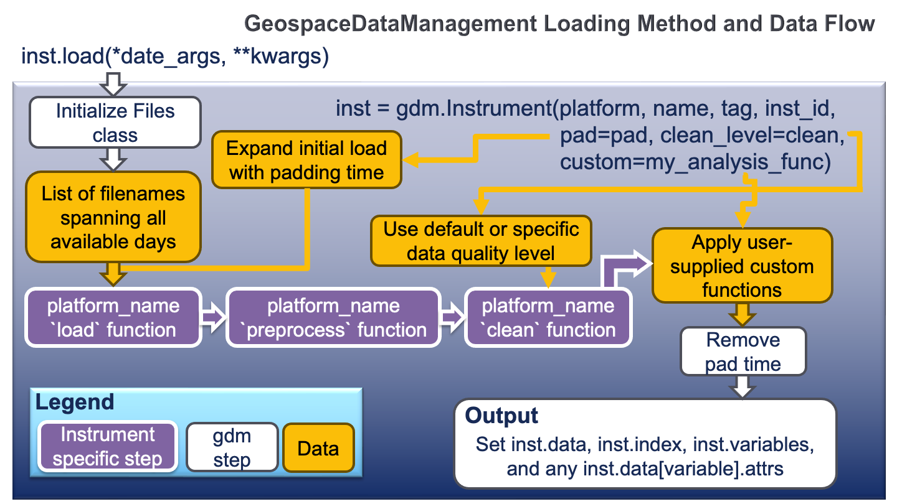

.. _tutorial-load:

Data Loading
------------

The :py:meth:`~GeospaceDataMangement._instrument.Instrument.load` method takes
care of a lot of the processing details needed to produce a scientifically
useful data set.  The image below provides an overview of this process.

Load Data
^^^^^^^^^

A single day (or file) may be loaded by the user into a
:py:class:`~GeospaceDataManagement._instrument..Instrument` object using the
:py:meth:`Instrument.load` method by specifying a year and day of year, date,
or filename.

.. code:: python

   import GeospaceDataManagement as gdm
   import datetime as dt

   # Set user and password for Madrigal
   username = 'Firstname Lastname'
   password = 'email@address.com'

   # Initialize the instrument, passing the username and password to the
   # standard routines that need it
   dmsp = gdm.Instrument(inst_module=gdm.instruments.dmsp_ivm, tag='utd',
                         inst_id='f12', user=username, password=password)

   # Define date range to download data
   start = dt.datetime(2001, 1, 1)
   stop = dt.datetime(2001, 1, 2)

   # Download data
   dmsp.download(start, stop)

   # Load by year, day of year
   dmsp.load(2001, 1)

   # Load by date
   dmsp.load(date=start)

   # Load by filename from string
   dmsp.load(fname='dms_ut_20010101_12.002.hdf5')

   # Load by filename in tag
   dmsp.load(fname=dmsp.files[0])

   # Load by filename in tag and specify date
   dmsp.load(fname=dmsp.files[start])

When the :py:meth:`Instrument.load` method runs, it stores the intrument
data in the :py:attr:`Instrument.data` attribute,

.. code:: python

   # Display all data
   dmsp.data

which maintains full access to the underlying data library functionality.

:py:mod:`GeospaceDataManagement` uses xarray
`DataSet <https://docs.xarray.dev/en/stable/generated/xarray.Dataset.html>`_
under the hood to ensure uniformity of data processing and the ability to store
meta data. 

Load Data Range
^^^^^^^^^^^^^^^

:py:mod:`GeospaceDataManagement` also supports loading data from a range of
files or file dates. Given the potential change in user expectation when
supplying a list of filenames to load instead of loading using a range of dates,
:py:mod:`GeospaceDataManagement` has adopted a nomenclature to consistently
distinguish between inclusive and exclusive bounds. Keywords in
:py:mod:`GeospaceDataManagement` with :py:data:`end_*` are an exclusive bound,
similar to slicing :py:class:`numpy.ndarray` objects, while those with
:py:data:`stop_*` are an inclusive bound. The starting index is always
inclusive.

.. note:: Keywords for date or filename ranges that begin with :py:data:`end`
	  are used as an exclusive terminating bound, while keywords that begin
	  with :py:data:`stop` are used as an inclusive bound.

Loading a range of data by year and day of year. Termination bounds are
exclusive.

.. code:: python

   # Load by year, day of year from 2001, 1 up to but not including 2001, 3
   dmsp.load(2001, 1, end_yr=2001, end_doy=3)

   # The following two load commands are equivalent
   dmsp.load(2001, 1, end_yr=2001, end_doy2=2)
   dmsp.load(2001, 1)

Loading a range of data using :py:class:`datetime.datetime` limits. Termination
bounds are exclusive.

.. code:: python

   # Load by datetimes
   dmsp.load(date=dt.datetime(2001, 1, 1),
             end_date=dt.datetime(2001, 1, 3))

   # The following two load commands are equivalent
   dmsp.load(date=dt.datetime(2001, 1, 1),
             end_date=dt.datetime(2001, 1, 2))
   dmsp.load(date=dt.datetime(2001, 1, 1))

Loading a range of data using filenames. Termination bounds are inclusive.

.. code:: python

   # Load a single file
   dmsp.load(fname='dms_ut_20010101_12.002.hdf5')

   # Load by filename, from fname up to and including stop_fname
   dmsp.load(fname='dms_ut_20010101_12.002.hdf5',
             stop_fname='dms_ut_20010102_12.002.hdf5')

   # Load by filenames using the DMSP object to get valid filenames
   dmsp.load(fname=dmsp.files[0], stop_fname=dmsp.files[1])

   # Load by filenames. Includes data from 2001, 1 up to but not
   # including 2001, 3
   dmsp.load(fname=dmsp.files[dt.datetime(2001, 1, 1)],
             stop_fname=dmsp.files[dt.datetime(2001, 1, 2)])

:py:mod:`GeospaceDataManagement` also supports loading all available data at
once, though this will create issues for large data sets. 

.. code:: python

   # F10.7 data
   f107 = gdm.Instrument(inst_module=gdm.instruments.sw_f107, tag='prelim')

   # Load all downloaded F10.7 solar flux data, from beginning to end.
   f107.load()

Clean Data
^^^^^^^^^^

Before data is available in :py:attr:`Instrument.data` it passes through
an instrument specific cleaning routine. The amount of cleaning is set by the
:py:attr:`clean_level` attribute, which may be specified at instantiation. The
level defaults to ``'clean'``.

.. code:: python

   dmsp = gdm.Instrument(platform='dmsp', name='ivm', tag='utd',
                         inst_id='f12', clean_level=None)
   dmsp = gdm.Instrument(platform='dmsp', name='ivm', tag='utd',
                         inst_id='f12', clean_level='clean')

Four levels of cleaning may be specified,

===============     ====================================
**clean_level** 	        **Result**
---------------     ------------------------------------
  clean		      Generally good data
  dusty		      Light cleaning, use with care
  dirty		      Minimal cleaning, use with caution
  none		      No cleaning, use at your own risk
===============     ====================================

The user provided cleaning level is can be retrieved or reset from the attribute
:py:class:`Instrument.clean_level`. The details of the cleaning will
generally vary greatly between instruments.  Many instruments provide only two
levels of data: `clean` or `none`.

By default, :py:mod:`GeospaceDataManagement` is configured to use ``'clean'``
as the default value for :py:attr:`clean_level`. This setting may be updated
using :ref:`tutorial-params`.
